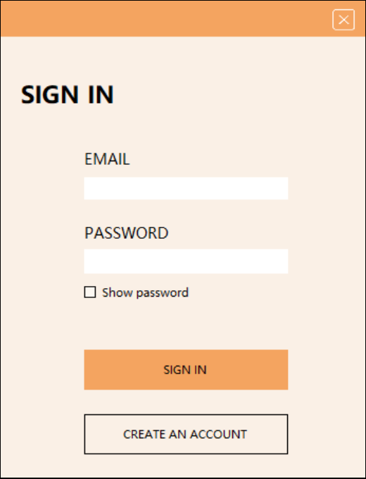
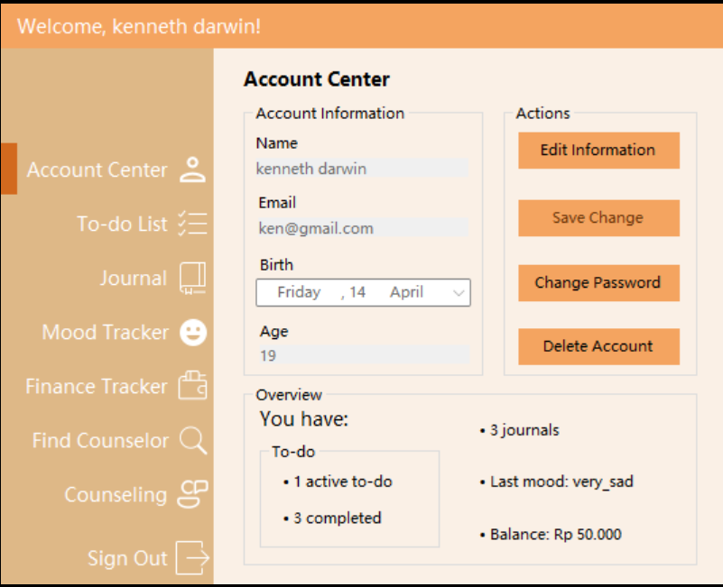
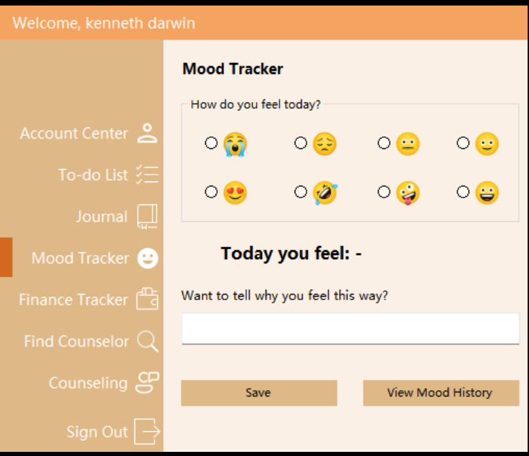
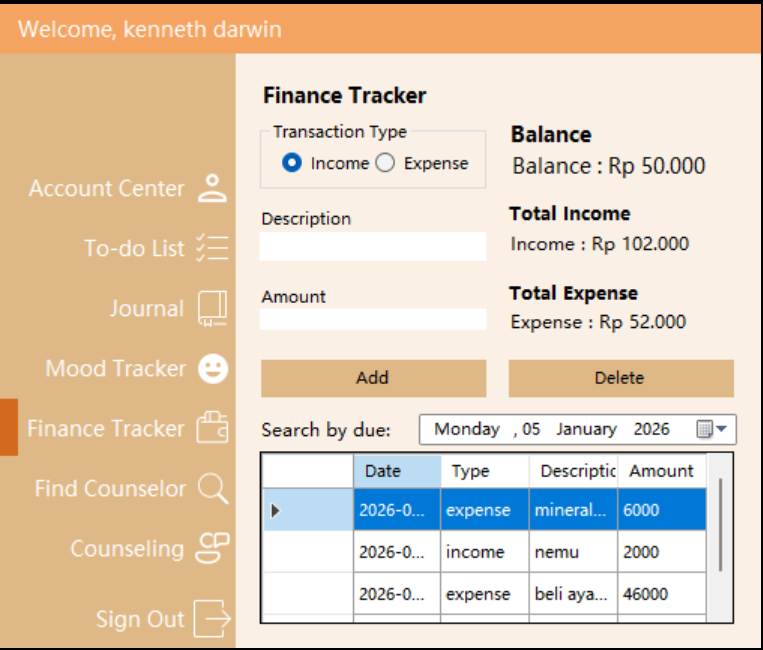
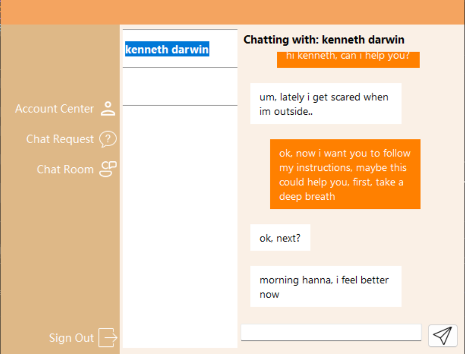
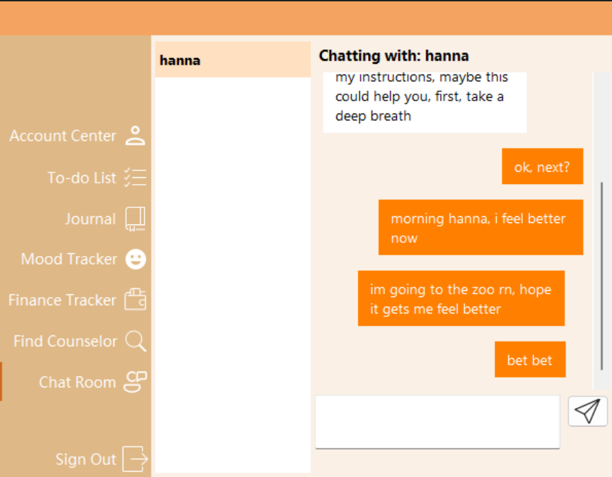

# Self-Care & Mental Health Management Application

A desktop application developed with **VB.NET (Windows Forms)** and **SQLite** designed to help students manage daily mental wellness, personal productivity, and peer/counselor consultations in a single platform.

## Application Preview

| Sign In | Account Center & Overview |
| :---: | :---: |
|  |  |

| Mood Tracker | Personal Finance Tracker |
| :---: | :---: |
|  |  |

| Student Consultation View | Counselor Consultation View |
| :---: | :---: |
|  |  |

## Key Features

### Student / User Module
- **Authentication & Account Overview:** Secure sign-up, login, profile updates, password management, and a centralized dashboard summarizing active tasks, journal counts, latest mood, and current balance (`SignIn`, `SignUp`, `AccountCenterUser`, `ChangePassword`).
- **Mood Tracker & History:** Daily emotional state logging with visual mood indicators and contextual notes (`MoodTracker`, `MoodHistory`).
- **Personal Journaling:** Private digital diary with date-based filtering for daily self-reflection (`Journal`).
- **Task & Expense Management:** Built-in to-do list with due-date search and completion tracking (`ToDoList`, `ToDoHistory`), paired with an income/expense tracker that automatically calculates net balance (`FinanceTracker`).
- **Counselor Consultation:** Browse available counselors by specialization, submit consultation requests, and chat directly within the app (`FindCounselor`, `PairWithCounselor`, `ChatRoom`).

### Counselor Module
- **Consultation Request & Chat Management:** Review incoming student requests (`IncomingReq`), manage counselor profiles (`AccountCenterCounselor`), and conduct text-based counseling sessions (`ChatRoom`).

## Tech Stack
- **Language & Framework:** Visual Basic .NET (VB.NET), .NET Framework (Windows Forms)
- **Database:** SQLite (`selfcare_app.db` — schema available in `database/schema.sql`)
- **IDE & Tools:** Microsoft Visual Studio, DB Browser for SQLite

## Planned Improvements
- Adding automated monthly mood trend charts and financial summary exports.
- Implementing cryptographic password hashing (bcrypt/SHA-256) for enhanced account security.
